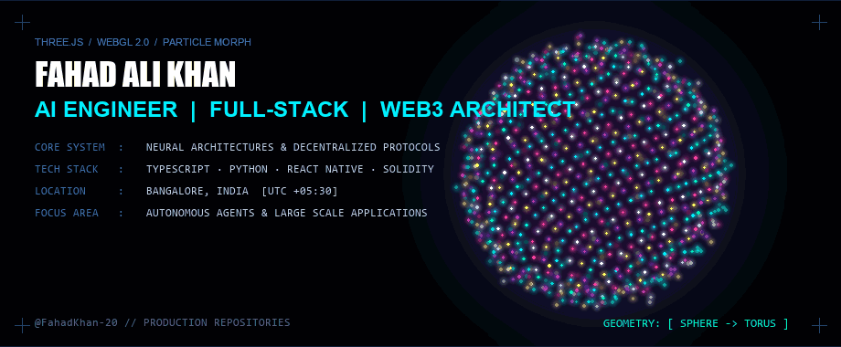

<!-- 3D WebGL Particle Morph Hero Banner (Sphere -> Torus -> Helix) -->

  

<!-- Holographic Rotating Profile Picture -->

 

<!-- Dynamic Neon Typing SVG -->

 

<!-- Real-Time Metrics & Badges -->

  
  
  

---

## 👨‍💻 About Me

I am an **AI Engineer**, **Full-Stack Developer**, and **Mobile Architect** based in **Bangalore, India**. I specialize in engineering autonomous AI systems, high-performance React Native & Kotlin mobile applications, and decentralized Web3 protocols.

- 🔭 **Currently Building**: Next-gen autonomous AI agents & scalable full-stack platforms
- 🌱 **Deep Diving Into**: Distributed Systems Architecture, Multi-Agent LLM Orchestration & Cloud Computing
- 📱 **Mobile Craft**: Production-ready React Native & native Android architecture
- ⛓️ **Web3 Architecture**: Decentralized collaboration suites & Solidity smart contracts
- 💬 **Ask Me About**: Full-Stack Architecture, AI Automation, React Native internals, Web3 dApps
- ⚡ **Fun Fact**: Passionate about astrodynamics simulations and deconstructing how low-level systems & version control work under the hood!

---

## 🚀 Featured Production Systems

<table>
  <tr>
    <td width="50%" valign="top">
      <h3 align="left">🌐 <a href="https://github.com/FahadKhan-20/NEXMEET">NexMeet</a></h3>
      
<b>Next-Generation Web3 Virtual Meeting & Collaboration Suite</b>

      
Decentralized collaboration platform redefining remote work through cryptographically authenticated identity, blockchain-backed room states, and low-latency real-time video/audio channels.

      

        
        
        
        
      

    </td>
    <td width="50%" valign="top">
      <h3 align="left">📊 <a href="https://github.com/FahadKhan-20/NEXCEL">NEXCEL</a></h3>
      
<b>Modern Cloud Spreadsheet & Dynamic Formula Engine</b>

      
High-performance web spreadsheet application built from the ground up featuring complex formula parsing, dependency-graph cell re-computation, and real-time analytical data visualization.

      

        
        
        
      

    </td>
  </tr>
  <tr>
    <td width="50%" valign="top">
      <h3 align="left">🏎️ <a href="https://github.com/FahadKhan-20/Autronix">Autronix</a></h3>
      
<b>Luxury Mobility & Vehicle Reservation Platform</b>

      
Mobile platform delivering a frictionless luxury mobility booking experience with native performance, gesture-driven interfaces, and modular state architecture.

      

        
        
        
      

    </td>
    <td width="50%" valign="top">
      <h3 align="left">🌙 <a href="https://github.com/FahadKhan-20/lunar-landing">Lunar Landing Site Navigator</a></h3>
      
<b>Artemis & CLPS Autonomous Mission Simulation</b>

      
Autonomous multi-criteria landing site planning, planetary ephemeris modeling, and line-of-sight horizon simulation system engineered for lunar south pole exploration.

      

        
        
        
      

    </td>
  </tr>
  <tr>
    <td width="50%" valign="top">
      <h3 align="left">👁️ <a href="https://github.com/FahadKhan-20/Drowsiness-detector">Drowsiness Detector</a></h3>
      
<b>AI-Powered Real-Time Driver Safety Co-Pilot</b>

      
Real-time computer vision system tracking ocular aspect ratios, blink durations, and head posture to identify early signs of driver fatigue and mitigate accident risks.

      

        
        
        
      

    </td>
    <td width="50%" valign="top">
      <h3 align="left">⚙️ <a href="https://github.com/FahadKhan-20/git">Git From Scratch</a></h3>
      
<b>Version Control Plumbing & DAG Storage Reimplementation</b>

      
Ground-up implementation of Git's core internal architecture — SHA object hashing, index staging, tree objects, commit graphs, and plumbing subcommands.

      

        
        
        
      

    </td>
  </tr>
</table>

---

## 🛠️ Technology Stack & Toolchain

#### Languages

 

#### Frameworks, Mobile & Frontend

 

#### Backend, Databases & Infrastructure

 

#### AI, Computer Vision & Development Environment

---

## 🐍 Contribution Activity Matrix

  <picture>
    <source media="(prefers-color-scheme: dark)" srcset="https://raw.githubusercontent.com/FahadKhan-20/FahadKhan-20/output/github-snake-dark.svg" />
    <source media="(prefers-color-scheme: light)" srcset="https://raw.githubusercontent.com/FahadKhan-20/FahadKhan-20/output/github-snake.svg" />
    
  </picture>

---

## 📊 Real-Time GitHub Analytics

  
  

  

  

---

## 🤝 Connect & Network

  
  &nbsp;
  
  &nbsp;
  
  &nbsp;
  

 

